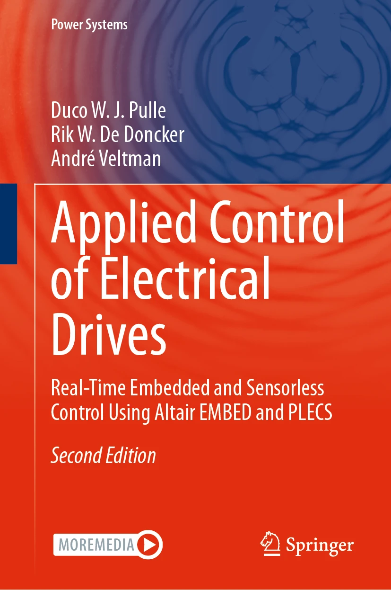

# Applied Control of Electrical Drives
This repository accompanies the book [*Applied Control of Electrical Drives. Real-Time Embedded and Sensorless Control Using Altair Embed and PLECS*](https://link.springer.com/book/9783032204844) by De Doncker, Pulle, and Veltman (Springer 2027).

